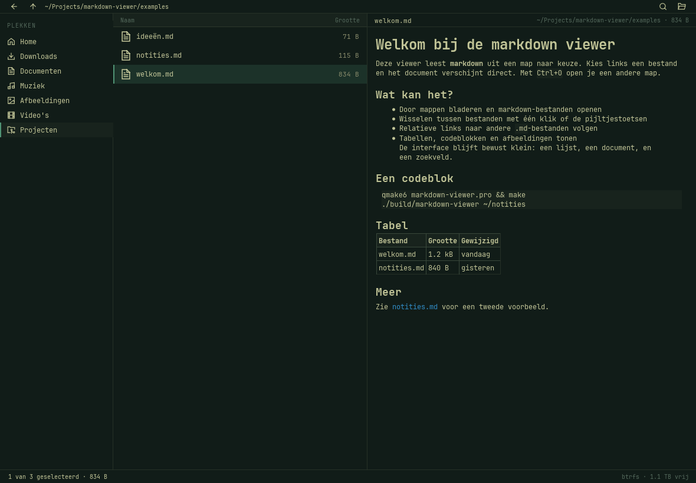

# Markdown viewer

Een kleine, native markdown-viewer voor de desktop, in de opmaak van
[Flea](https://github.com/thisisgm/flea): monospace, compacte balken van 23 px,
een rail van 25 px hoge rijen en lijstrijen van 32 px, Lucide-lijniconen en
vierkante selecties met een accentrand. Alles volgt het actieve Omarchy-thema.



## Wat het doet

- **Zijbalk met plekken** (Home, Downloads, Documenten, Muziek, Afbeeldingen,
  Video's, Projecten); de huidige plek licht op met een accentrand.
- **Terug** en **omhoog** in de bovenbalk, met het pad ernaast.
- **Zoeken** (`Ctrl+F`) verandert de kolomkop in een zoekveld; `Esc` sluit het
  weer. Alleen de bestandslijst wordt gefilterd.
- **Map kiezen** via het mapicoon rechts in de bovenbalk (`Ctrl+O`). De laatste
  map en het laatste bestand worden onthouden.
- Lijst met submappen en markdown-bestanden (`.md`, `.markdown`, `.mdown`,
  `.mkd`), met naam en grootte; verborgen bestanden worden overgeslagen.
- Documentkolom met koppen, lijsten, takenlijsten, tabellen, codeblokken,
  blokquotes, afbeeldingen en relatieve links naar andere markdown-bestanden.
- Statusbalk met het aantal items of de selectie, en de vrije schijfruimte.

Geen browser, geen server, geen dependencies buiten Qt.

## Installeren

```bash
bin/install
```

Dat bouwt de app en installeert `markdown-viewer` in `~/.local/bin`, plus een
launcher-item en icoon in `~/.local/share`. Daarna start je hem via de
app-launcher (Super+Space) of vanaf de terminal:

```bash
markdown-viewer            # opent de laatst gebruikte map
markdown-viewer ~/notities # opent die map
markdown-viewer notitie.md # opent dat bestand
```

Verwijderen: `bin/uninstall` (je instellingen blijven staan).

## Sneltoetsen

| Toets | Actie |
|-------|-------|
| `↑` / `↓` | Door de lijst; bestanden worden direct getoond |
| `Enter` | Map openen |
| `Alt+←` | Terug naar de vorige map |
| `Alt+↑` | Eén map omhoog |
| `Ctrl+O` | Andere map kiezen |
| `Ctrl+F` | Zoekveld openen |
| `Esc` | Zoeken sluiten of terug naar de lijst |
| `Ctrl+Q` | Afsluiten |

## Bouwen en testen

```bash
bin/build   # qmake6 + make -> build/markdown-viewer
bin/test    # Qt-test zonder scherm
```

Een schermafbeelding maken zonder je desktop te storen:

```bash
bin/screenshot                          # docs/screenshot.png
bin/screenshot ~/notities /tmp/shot.png # eigen map en uitvoerpad
```

## Opbouw

```
markdown-viewer.pro   qmake-project
src/main.cpp          app-start, venster en icoon
src/mainwindow.*      venster, plekken-rail, lijst, document, navigatie
src/theme.*           Omarchy-kleuren, tekstschaal en stylesheets
src/markdown-viewer.svg
examples/             voorbeeldnotities
tests/                tests en offscreen-screenshot-harnas
bin/build|test|screenshot|install|uninstall
```

Instellingen (laatste map, laatste bestand, venstergrootte) staan in
`~/.config/bart/markdown-viewer.conf`.

## Geschiedenis

De eerdere browser-versie is verwijderd. Een backup daarvan staat in
`~/Projects/markdown-viewer-web-backup-*.tar.gz`.
